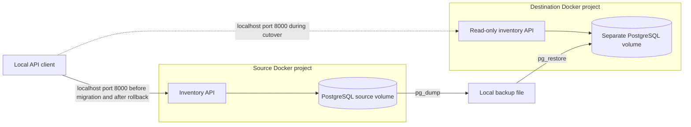

# Inventory application migration rehearsal

**Simulated company project · Local Docker environments · Python + PostgreSQL**

## Problem

A company needs to move an inventory application and its database to another environment while preserving records and retaining a safe way to return to the original system. This exercise simulates that move on one computer without a cloud account.

## System

Each Docker project has its own network and database volume. The database ports are private. The API listens on loopback only, and credentials and backup files are excluded from Git.

## Decisions

- Use an offline migration: stopping the sole application writer gives a clear write boundary. This accepts downtime in exchange for a simpler correctness argument.
- Use PostgreSQL's native backup and restore tools, with the same major database version at both ends.
- Restore into a fresh destination and refuse to overwrite an existing destination.
- Compare every record and the identity sequence state, rather than only comparing record counts.
- Keep the destination read-only during the rehearsal so rollback does not discard destination writes.
- Reuse the source application image for the destination. Change environment configuration and port binding for the cutover.
- Preserve source data and automatically attempt recovery if a later step fails.

## Observed results

The run on 2026-10-28 passed backup, restore, record comparison, identity-sequence comparison, API checks, cutover at the original URL, and rollback. The dataset contained **one synthetic inventory record**. Cutover downtime was **26.054 seconds**; rollback downtime was **9.286 seconds**. These timings describe this local run, not a production performance target.

The initial verification query failed because a PostgreSQL sequence cannot be converted through the composite-row expression used. Automatic recovery brought back the source. The query was corrected to compare explicit sequence fields, and the subsequent rehearsal passed. Failed and successful run reports remain in the local backup folder.

The separate application smoke check also demonstrated persistence across container restarts and rejection of six invalid input cases without saving records.

## Evidence

- [Application](app.py), [container topology](compose.yaml), and [image build](Dockerfile)
- [Repeatable application check](smoke-test.mjs)
- [Migration implementation](migrate.mjs) and [operational runbook](MIGRATION.md)
- [Successful migration report](migration-evidence.json)
- [Demo guide](DEMO.md)

## Limits and next steps

Both environments share one host. The backup is also on that host and does not protect against its loss. This is not a completed cloud migration, a high-availability design, or a load test. The local API has no authentication and must not be exposed publicly. The read-only flag blocks API writes; it does not restrict privileged database users.

A real cloud stage would need an account, current cost and credit checks, infrastructure provisioning, cloud access controls, secure connectivity, remote backup storage, and fresh migration evidence. A writable destination would also need a plan for reconciling changes before rollback. None of those capabilities are claimed here.

## Suggested CV wording

“Built a local migration lab for a Python/PostgreSQL application using Docker Compose. Automated backup and restore to an isolated environment, verified records and identity sequence state, and rehearsed read-only cutover and rollback with measured downtime.”

Use this wording after you can run the checks and explain the decisions yourself. Describe it as a learning project, not professional migration experience.
